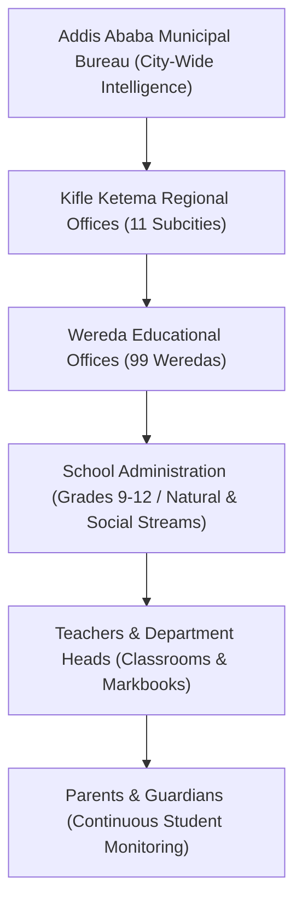
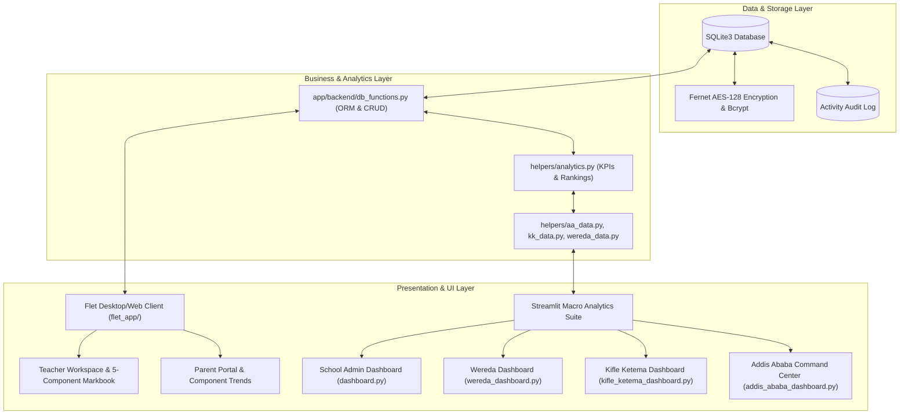

# LIQ

### Multi-Tier Educational Performance Intelligence & Academic Analytics Platform

[](https://www.python.org/)
[](https://flet.dev/)
[](https://streamlit.io/)
[](https://plotly.com/)
[](https://www.sqlite.org/)
[](https://cryptography.io/)

> **LIQ** is a centralized, hierarchical educational analytics and academic intelligence platform designed to transform how student and school performance data is captured, analyzed, and acted upon—scaling seamlessly from classroom continuous-assessment markbooks up to municipal-level governance.

---

## Table of Contents

- [Overview](#overview)
- [The Problem](#the-problem)
- [The Solution](#the-solution)
- [System Hierarchy & Access Architecture](#system-hierarchy--access-architecture)
- [Core Capabilities](#core-capabilities)
- [Interactive Visual Showcase & Dashboards](#interactive-visual-showcase--dashboards)
  - [Main LIQ Welcome & Launch Portal](#main-liq-welcome--launch-portal)
  - [1. Parent Portal](#1-parent-portal)
  - [2. Teacher Workspace & Markbook](#2-teacher-workspace--markbook)
  - [3. School Administration Dashboard](#3-school-administration-dashboard)
  - [4. Wereda Performance Dashboard](#4-wereda-performance-dashboard)
  - [5. Kifle Ketema / Subcity Dashboard](#5-kifle-ketema--subcity-dashboard)
  - [6. Addis Ababa City Command Center](#6-addis-ababa-city-command-center)
- [Analytics & Diagnostic Intelligence](#analytics--diagnostic-intelligence)
- [Traditional Systems vs. LIQ](#traditional-systems-vs-liq)
- [System Architecture](#system-architecture)
- [Security, Privacy & Data Handling](#security-privacy--data-handling)
- [Technology Stack](#technology-stack)
- [Repository Structure](#repository-structure)
- [Getting Started & Installation](#getting-started--installation)
- [Current Implementation Status](#current-implementation-status)
- [Future Roadmap](#future-roadmap)
- [Why LIQ Matters](#why-liq-matters)
- [Conclusion](#conclusion)

---

## Overview

In many educational ecosystems, student assessment data remains isolated in paper gradebooks, unlinked spreadsheets, and decentralized administrative offices. This structural fragmentation creates reporting delays of weeks or months, preventing teachers, school leadership, and municipal authorities from identifying academic vulnerabilities before high-stakes examinations.

**LIQ** unifies educational performance monitoring through an integrated, multi-tier software system composed of two complementary presentation environments:
1. **Flet (Flutter Engine) Client Application:** A cross-platform desktop and web workspace providing secure authentication, role-based workflows, 5-component continuous markbook recording, attendance tracking, and individual student progress analytics.
2. **Streamlit & Plotly Macro Analytics Suite:** A high-throughput analytical suite providing executive dashboards, institutional benchmarking, statistical variance analysis, and multi-dimensional heatmaps across schools, districts (Weredas), subcities (Kifle Ketemas), and municipal authorities (Addis Ababa).

---

## The Problem

```
┌──────────────────────────────────────────────────────────────────┐
│                   Traditional Educational Flow                   │
│                                                                  │
│  Paper / Excel   ──►  End-of-Term Delay  ──►  Reactive Actions   │
│  (Data Silos)          (Late Detection)        (Too Late to Help)│
└──────────────────────────────────────────────────────────────────┘
```

Modern educational institutions and administrative bodies face persistent operational hurdles:

* **High Information Latency:** Critical learning gaps and attendance drops are typically identified only at the conclusion of a semester or academic term, making timely remedial action difficult.
* **Lack of Granular Component Visibility:** Parents receive summary scores without visibility into individual continuous-assessment components (worksheets, quizzes, midterm exams, projects).
* **Subject & Cohort Blindspots:** School administrators lack real-time tools to detect specific subject-level disparities or identify sections falling behind curriculum milestones.
* **Inter-School & Regional Disparities:** District supervisors and regional education officers lack standardized, comparative data to evaluate school performance, identify resource deficits, or share pedagogical best practices.
* **Data Security & Privacy Vulnerabilities:** Traditional paper registers and unprotected spreadsheets risk data loss, tampering, and unauthorized disclosure of confidential student records.

---

## The Solution

```
┌──────────────────────────────────────────────────────────────────┐
│                       The LIQ Approach                           │
│                                                                  │
│  Continuous Capture ──► Real-Time Synthesis ──► Proactive Action │
│  (5-Component Mark)     (Multitier KPIs)        (Early Warnings) │
└──────────────────────────────────────────────────────────────────┘
```

LIQ replaces fragmented, manual workflows with an integrated, transparent digital continuum:

* **5-Component Continuous Assessment:** Captures structured continuous coursework (Worksheets /10, Tests /10, Assignments /10, Midterms /30, and Finals /40) with automated validation.
* **Multi-Tier Role-Based Access:** Delivers dedicated, scoped dashboards tailored to parents, teachers, principals, district officers, subcity supervisors, and municipal directors.
* **Automated Early Warning Signals:** Algorithmic heuristics immediately flag students, classes, or districts scoring below passing thresholds (<60%).
* **Institutional Benchmarking & Heatmaps:** Visual matrices enable supervisors to inspect subject-level mastery patterns across schools and administrative zones.
* **Cryptographic Safeguards:** Employs Bcrypt password hashing and Fernet AES-128 symmetric encryption to protect credentials, student identifiers, and audit logs.

---

## System Hierarchy & Access Architecture

LIQ mirrors the real-world operational hierarchy of municipal educational systems, enforcing strict role-based access scopes at each governance level:

| Governance Level | Primary Role | Access Scope | Operational Purpose |
| :--- | :--- | :--- | :--- |
| **Parent / Guardian** | Parent | Individual Student Record | Track child's 5-component scores, quarterly trends, and teacher notes |
| **Classroom Staff** | Teacher | Assigned Section / Grade | Continuous markbook entry, attendance recording, top-student recognition |
| **School Leadership** | School Administrator | School-Wide (Grades 9–12) | Stream tracking (Natural vs. Social), section rankings, subject variance |
| **Wereda Administration** | District Education Officer | Multi-School District | Cross-school rankings, institutional KPI heatmaps, variance monitoring |
| **Subcity (Kifle Ketema)** | Regional Supervisor | Regional Weredas | Inter-wereda comparison, pass vs. at-risk ratios, subject-level regional matrix |
| **Municipal Bureau** | City Educational Leader | All 11 Subcities & 99 Weredas | Capital-wide intelligence, executive priority alerts, macro policy analysis |



---

## Core Capabilities

* **Standardized 5-Component Continuous Grading:** Enforces balanced assessment weighting with real-time input validation and total score computation.
* **Attendance Tracking & Correlation:** Records student attendance percentages alongside academic marks to assess engagement impact.
* **Longitudinal Progress Tracking:** Visualizes quarter-by-quarter score trajectories across Q1, Q2, Q3, and Q4.
* **Statistical Performance Spread:** Computes score dispersion (max - min) and sample variance ($\sigma^2$) to evaluate learning equity within cohorts.
* **Dynamic Student & Section Rankings:** Computes top performers for 1st Semester, 2nd Semester, and Full Year alongside class-wide ranking matrices.
* **Academic Stream Separation:** Dedicated analytical segregation for General Secondary (Grades 9–10) and Preparatory tracks (Grade 11 & 12 Natural Science vs. Social Science).
* **Multi-Dimensional Heatmaps:** Renders interactive matrix visualizations mapping geographic divisions directly against curriculum subjects.

---

## Interactive Visual Showcase & Dashboards

---

### Main LIQ Welcome & Launch Portal

The LIQ application opens with a clean, accessible interface designed for educators, school leaders, and families.

#### Welcome Interface
Interactive showcase introducing the platform.

.png>)

#### Portal Launch Screen
Primary starting screen routing users into role authentication.

.png>)

---

### 1. Parent Portal

The **Parent Portal** provides families with direct visibility into their child's academic progress throughout the academic year.

#### Implemented Features:
* **Academic Summary Cards:** Cumulative overall average, highest-performing subject, areas requiring attention, and quarter completion status.
* **Continuous Component Score Trends:** Longitudinal line charts tracking progress across all five individual continuous assessment components (Worksheet, Test, Assignment, Mid Exam, Final Exam).
* **Quarterly Subject Standings & Distribution:** Visual breakdowns of subject-level scores with mastery distribution donut charts.
* **Teacher Notes & Observations:** Direct access to feedback and recommendations recorded by classroom teachers.

#### Visual Showcase:

.png>)

.png>)

.png>)

---

### 2. Teacher Workspace & Markbook

The **Teacher Workspace** provides classroom educators with a dedicated cockpit for grading, attendance, and student performance diagnostics.

#### Implemented Features:
* **Interactive 5-Component Markbook:** Live validation and grade capture for Worksheet (/10), Test (/10), Assignment (/10), Mid Exam (/30), and Final Exam (/40) with automatic summation.
* **Class Overview & Metrics:** Instant visibility into overall class average, leading subject average, section attendance rate, and top-ranking student.
* **Longitudinal Class Trends:** Line charts tracking class average movement across Q1, Q2, Q3, and Q4.
* **Top Performer Recognition & Full Rankings:** Automated calculation of Top 5 student recognition snapshots for 1st Semester, 2nd Semester, and Full Year, alongside a sortable class-wide ranking table.

#### Visual Showcase:

.png>)

.png>)

.png>)

---

### 3. School Administration Dashboard

The **School Administration Dashboard** equips school principals, vice principals, and department heads with school-wide monitoring across all sections and grades.

#### Implemented Features:
* **School-Wide KPI Banner:** Real-time synthesis of School Overall Average, Pass Rate ($\ge 60\%$), Distinction Rate ($\ge 75\%$), and At-Risk Student Percentage ($<60\%$).
* **Grade & Section Navigator:** Dedicated views for Grades 9, 10, 11, and 12, with explicit classification for Natural Science and Social Science tracks.
* **Cross-Section Comparative Analytics:** Side-by-side performance evaluation across class sections (e.g., 9A vs. 9B vs. 9C vs. 9D).
* **Subject Performance Gap Analysis:** Highlights curriculum areas with significant variance between top-performing and struggling sections.

#### Visual Showcase:

.png>)

.png>)

---

### 4. Wereda Performance Dashboard

The **Wereda Dashboard** enables district education officers to supervise multiple schools within their jurisdiction, identifying institutional inequities and facilitating targeted support.

#### Implemented Features:
* **Multi-School Institutional Grid:** Direct access to individual school profiles across the district (e.g., NEPS, Omega, Cruise, School of Tomorrow, BGIS, SOS, and others).
* **Wereda Academic KPI Banner:** Aggregates district-wide averages, overall pass percentages, and distinction rates across all schools and grade levels.
* **Wereda KPI Heatmap:** Color-coded matrix comparing Average Scores, Pass Rates, Distinction Rates, At-Risk Percentages, and Top Performer Rates across district units.
* **Multi-School Comparative Benchmark Table:** Tabular analysis ranking schools by composite academic performance.

#### Visual Showcase:

.png>)

.png>)

---

### 5. Kifle Ketema / Subcity Dashboard

The **Kifle Ketema Dashboard** provides regional educational supervisors with macro intelligence across all constituent Weredas in the subcity.

#### Implemented Features:
* **Regional Command Banner:** Combined average score, regional pass rate, distinction yield, at-risk percentage, top-performer rate, and quarter-over-quarter improvement ($\Delta \%$).
* **Subcity Selector & Operational Matrix:** Quick navigation across administrative divisions with immediate status indicators.
* **Pass Rate vs. At-Risk Cross-Analysis:** High-contrast comparative bar charts evaluating pass rates directly alongside at-risk student percentages per district.
* **Subject-by-District Heatmap Matrix:** Visual matrix tracking subject-level competency (Mathematics, English, Amharic, Physics, Chemistry, Biology, Social Studies) across all subcity districts.

#### Visual Showcase:

.png>)

.png>)

.png>)

.png>)

---

### 6. Addis Ababa City Command Center

The **Addis Ababa City Dashboard** serves as the executive intelligence center for municipal education bureau leaders, policy researchers, and government stakeholders.

#### Implemented Features:
* **Capital-Wide Macro Analytics:** Aggregates metrics across all 11 Kifle Ketemas (Bole, Arada, Yeka, Kirkos, Lideta, Addis Ketema, Akaki Kality, Kolfe Keranio, Nifas Silk-Lafto, Gulele, Lemi Kura) and 99 constituent Weredas.
* **Executive Priority Categorization:** Automated cards highlighting the **Top Performing Kifle Ketema** (e.g., *Nifas Silk-Lafto*) alongside areas that **Need Immediate Attention** (e.g., *Addis Ketema*).
* **Cross-Kifle Ketema Ranking:** Standardized ranking of all 11 subcities by composite academic average and term improvement.
* **City-Wide Subject Heatmap:** Comprehensive matrix evaluating subject-wise performance across all subcities to inform city-wide curriculum interventions.

#### Visual Showcase:

.png>)

.png>)

.png>)

.png>)

---

## Analytics & Diagnostic Intelligence

LIQ's analytics engine is implemented through modular Python packages (`helpers/analytics.py` and `flet_app/services/analytics.py`), translating raw scores into actionable diagnostics.

### 1. Assessment Model & Component Summation
Continuous assessment follows the 5-component weighted structure:

$$	ext{Final Total} = \sum_{i=1}^{5} 	ext{Component}_i = 	ext{Worksheet}_{(0-10)} + 	ext{Test}_{(0-10)} + 	ext{Assignment}_{(0-10)} + 	ext{Mid Exam}_{(0-30)} + 	ext{Final Exam}_{(0-40)}$$

### 2. Statistical Metrics & Spread Formulations
* **Class & Subject Means:** Arithmetic mean per subject discipline across recorded terms:
  $$\mu_{	ext{subject}} = rac{1}{N} \sum_{k=1}^{N} 	ext{Mark}_k$$
* **Score Spread / Performance Gap:** Quantifies the disparity within a classroom:
  $$	ext{Gap}_{	ext{subject}} = \max(	ext{Mark}) - \min(	ext{Mark})$$
* **Score Variance:** Statistical variance ($\sigma^2$) measuring learning homogeneity across a section.
* **Quarter-over-Quarter Improvement Delta:** Percentage momentum between terms:
  $$\Delta \% = \left(rac{\mu_{	ext{Term 2}} - \mu_{	ext{Term 1}}}{\mu_{	ext{Term 1}}}
ight) 	imes 100$$

### 3. Rule-Based Early Warning & Actionable Heuristics
Rather than ungrounded black-box models, LIQ implements transparent, rule-based diagnostic heuristics:

| Classification | Threshold Rule | System Action |
| :--- | :--- | :--- |
| **Distinction Cohort** | $	ext{Average} \ge 75\%$ | Flagged for academic recognition and advanced enrichment |
| **Active Baseline** | $65\% \le 	ext{Average} < 75\%$ | Classified as stable baseline performance |
| **Moderate Vulnerability** | Subject Mean $< 70\%$ | Highlighted in diagnostic summaries for focused reinforcement |
| **Critical At-Risk** | Student / Subject Mean $< 60\%$ | Immediate warning flag; triggers alert in parent and teacher views |

```python
def get_prediction_trend(df: pd.DataFrame) -> str:
    overall_avg = df["Mark"].mean()
    subject_avg = get_class_avg_per_subject(df)
    weak_subjects = subject_avg[subject_avg < 70].index.tolist()
    critical_subjects = subject_avg[subject_avg < 60].index.tolist()

    if overall_avg >= 75:
        return "Strong overall performance. If current trends continue, academic results are projected to remain excellent."
    elif overall_avg >= 65:
        return f"Moderate performance. Targeted practice in ({', '.join(weak_subjects)}) is recommended to accelerate improvement."
    else:
        return f"Below-average performance detected. Immediate intervention recommended in: {', '.join(critical_subjects)}."
```

---

## Traditional Systems vs. LIQ

| Operational Dimension | Traditional Educational Monitoring | The LIQ Platform |
| :--- | :--- | :--- |
| **Data Capture** | Physical markbooks, manual paper ledgers, fragmented files | Centralized relational SQLite schema with referential integrity |
| **Reporting Cycle** | End-of-semester or end-of-year batch compilation | Immediate real-time metric computation upon grade entry |
| **Data Scope** | Isolated per teacher or school office | Hierarchical roll-up: Student $
ightarrow$ School $
ightarrow$ Wereda $
ightarrow$ Subcity $
ightarrow$ City |
| **Assessment Granularity** | Single summary percentage | 5-component breakdown (Worksheet, Test, Assignment, Mid, Final) |
| **Analytical Depth** | Manual addition and basic averages | Statistical variance, score spread, quartile ranks, multi-level heatmaps |
| **Early Warning** | Reactive; identified after examination failure | Proactive; automated at-risk flags and component trend tracking |
| **Multi-School Comparisons** | Labor-intensive manual surveys with delayed synthesis | Interactive cross-school, Wereda, and Subcity comparative dashboards |
| **Parent Engagement** | Periodic physical report cards | On-demand digital portal with component-level trends & teacher notes |
| **Credential & Data Security** | Unencrypted spreadsheets or open files | Bcrypt credential hashing and Fernet AES-128 PII encryption |

---

## System Architecture

LIQ is architected around a clean separation of concerns: a core SQLite relational data store, a Python-based business/analytics logic layer, and dual presentation clients tailored for different operational contexts.



---

## Security, Privacy & Data Handling

Educational records contain sensitive personally identifiable information (PII). LIQ implements architectural controls directly in the codebase:

* **Bcrypt Credential Hashing:** Passwords for teachers, parents, and administrative staff are salted and hashed using `bcrypt`. Plaintext passwords are never stored.
* **Fernet Symmetric Encryption:** Sensitive fields such as student ID codes and specific audit log details are encrypted using Fernet (AES-128 in CBC mode with HMAC authentication) via the Python `cryptography` library.
* **Relational Database Integrity:** Foreign key enforcement (`PRAGMA foreign_keys = ON;`) with cascading deletions maintains referential integrity across students, subjects, terms, grades, and attendance.
* **Immutable Activity Audit Log:** The `activity_log` table records login attempts, account creations, modifications, and credential updates with UTC timestamps.
* **Isolated Administrative Accounts:** Administrative credentials are stored in an isolated `admin_accounts` table separated from general user roles.
* **Demonstration & Development Mode:** The repository includes synthetic, realistic data generation modules (`helpers/data_gen.py`, `helpers/wereda_data.py`, `helpers/kk_data.py`, `helpers/aa_data.py`) for demonstration and validation without exposing real-world student data.

---

## Technology Stack

All technologies listed below have been verified directly against the project source files and dependency specifications (`requirements.txt`, `pyproject.toml`):

### Core Frameworks & Runtime
* **[Python 3.11+](https://www.python.org/):** Core runtime powering backend logic, analytics calculations, and UI frameworks.
* **[Flet (Flutter UI Engine)](https://flet.dev/):** Multi-platform desktop and web UI framework powering the interactive Teacher, Parent, and Admin client portals.
* **[Streamlit](https://streamlit.io/):** Analytical web application framework driving the high-performance administrative intelligence dashboards.

### Data Processing & Visualization
* **[Pandas](https://pandas.pydata.org/):** High-performance tabular data structures, grouping, multi-index aggregations, and pivoting operations.
* **[NumPy](https://numpy.org/):** Vectorized numerical operations, sample variance computations, and statistical evaluations.
* **[Plotly Express & Graph Objects](https://plotly.com/python/):** Generates interactive heatmaps, grouped bar charts, multi-line trend plots, and donut distributions.
* **[Openpyxl](https://openpyxl.readthedocs.io/):** Supports Excel workbook operations for structured data import and export.

### Database & Cryptography
* **[SQLite3](https://www.sqlite.org/):** Serverless, ACID-compliant relational database engine managing local and bundled application records.
* **[Bcrypt](https://pypi.org/project/bcrypt/):** Cryptographic library providing password hashing and verification.
* **[Cryptography (Fernet)](https://cryptography.io/):** Implements symmetric authenticated encryption for sensitive student and log data.

---

## Repository Structure

```text
LIQ/
├── README.md                           # Master project documentation & visual showcase
├── requirements.txt                    # Python package dependencies
├── pyproject.toml                      # Project configuration and build metadata
├── main.py                             # Flet application launch entry point
├── pro.py                              # Master consolidated application engine
│
├── dashboard.py                        # School Administration Streamlit Dashboard
├── admin_dashboard.py                  # Grade-level & section analytics dashboard
├── wereda_dashboard.py                 # Wereda multi-school performance dashboard
├── kifle_ketema_dashboard.py           # Kifle Ketema regional performance dashboard
├── addis_ababa_dashboard.py            # Addis Ababa city-wide command dashboard
│
├── flet_app/                           # Modular Flet multi-platform application package
│   ├── main.py                         # Flet application lifecycle controller
│   ├── constants.py                    # Assessment, regional, and school constants
│   ├── components/                     # Reusable UI widgets (charts, banners, tables)
│   ├── services/                       # Database, analytics, and cross-platform path services
│   ├── state/                          # Application, authentication, and selection state
│   └── views/                          # Role-based views (admin, parent, teacher, setup)
│
├── helpers/                            # Analytics, mock data generation, and plotting
│   ├── analytics.py                    # Statistical metrics, ranking, and early-warning algorithms
│   ├── charts.py                       # Plotly visualization generators
│   ├── data_gen.py                     # School-level data modeling & synthetic datasets
│   ├── wereda_data.py                  # Wereda-level data models and KPI helpers
│   ├── kk_data.py                      # Subcity-level data models and KPI helpers
│   ├── aa_data.py                      # Addis Ababa city-level data models and heatmaps
│   └── ui_components.py                # Custom CSS styling and card components
│
├── app/
│   └── backend/
│       └── db_functions.py             # SQLite CRUD, Fernet encryption, and audit log
│
├── assets/                             # Logos, branding graphics, and school badges
│
└── screenshots/                        # Documentation image assets
    ├── liq/                            # LIQ welcome and launch screenshots
    ├── parent/                         # Parent portal screenshots
    ├── teacher/                        # Teacher workspace and markbook screenshots
    ├── admin/                          # School administration dashboard screenshots
    ├── wereda/                         # Wereda performance dashboard screenshots
    ├── sub/                            # Kifle Ketema / Subcity dashboard screenshots
    └── aa/                             # Addis Ababa city command center screenshots
```

---

## Getting Started & Installation

### Prerequisites
* Python `3.11` or higher
* Git
* Recommended: Virtual environment (`venv` or `conda`)

### 1. Clone the Repository
```bash
git clone <repository-url>
cd LIQ
```

### 2. Configure Virtual Environment
```bash
# Windows
python -m venv venv
.\venv\Scripts\activate

# macOS / Linux
python3 -m venv venv
source venv/bin/activate
```

### 3. Install Dependencies
```bash
pip install -r requirements.txt
```

### 4. Running the Applications

#### Launch the Flet Desktop / Web Client:
```bash
python main.py
```

#### Launch the Regional Intelligence Dashboards (Streamlit):
```bash
# School Admin Dashboard
streamlit run dashboard.py

# Wereda Multi-School Dashboard
streamlit run wereda_dashboard.py

# Kifle Ketema Regional Dashboard
streamlit run kifle_ketema_dashboard.py

# Addis Ababa City Command Center
streamlit run addis_ababa_dashboard.py
```

---

## Current Implementation Status

| Feature / Module | Implementation Status | Technical Details |
| :--- | :---: | :--- |
| **5-Component Markbook** | **Complete** | Worksheet (/10), Test (/10), Assignment (/10), Mid (/30), Final (/40) |
| **Parent Portal** | **Complete** | Component trends, quarter standings, mastery donut charts |
| **Teacher Workspace** | **Complete** | Class averages, longitudinal trends, Top 5 recognition snapshots |
| **School Admin Dashboard** | **Complete** | Grade 9–12 section navigator, Natural/Social track separation |
| **Wereda Dashboard** | **Complete** | Multi-school benchmarking, Wereda KPI heatmaps, ranking tables |
| **Subcity Dashboard** | **Complete** | Regional KPI banner, pass vs. at-risk cross-analysis, subject matrix |
| **Addis Ababa Command Center** | **Complete** | 11-Subcity city-wide intelligence, priority cards, macro heatmap |
| **Rule-Based Early Warnings** | **Complete** | Heuristic triggers for at-risk (<60%) and vulnerable subjects (<70%) |
| **Cryptographic Security** | **Complete** | Bcrypt password hashing, Fernet AES-128 PII encryption, audit logs |

---

## Future Roadmap

The following capabilities are planned for upcoming development milestones:

* [ ] **Predictive Machine Learning Models:** Training supervised models (e.g., Random Forest or Gradient Boosting) on longitudinal multi-year datasets to predict national secondary examination pass probabilities.
* [ ] **Automated SMS & USSD Push Notifications:** Direct telecommunication integration to deliver low-bandwidth performance summaries and absence alerts to parents without smartphone access.
* [ ] **National Examination Ingestion:** Standardized connectors for National Educational Assessment and Examinations Agency (NEAEA) datasets.
* [ ] **Offline-First P2P Data Synchronization:** SQLite-to-SQLite synchronization protocols for rural schools with intermittent internet connectivity.
* [ ] **Mobile Native Builds:** Compiling standalone Android APK and iOS binaries using Flet's Flutter toolchain for field officers.

---

## Why LIQ Matters

Educational equity and quality improvement cannot occur without timely, verifiable data. By bridging the divide between individual classroom assessment and metropolitan educational policy, **LIQ** delivers:

1. **Empowered Families:** Parents become active partners in education through continuous, granular progress tracking.
2. **Supported Educators:** Teachers identify struggling students in weeks rather than months, enabling targeted instructional support.
3. **Data-Informed Administrators:** School leaders eliminate guesswork, deploying teaching resources where subject gaps are largest.
4. **Transparent Governance:** Municipal policymakers gain objective, verifiable benchmarks to allocate educational investments equitably.

---

## Conclusion

**LIQ** demonstrates how modern, open-source software engineering can bring transparency, efficiency, and intelligence to educational monitoring. By transforming raw grades into continuous, multi-tier insights, LIQ helps ensure that no student falls through the cracks unnoticed.

---

<div align="center">
  <sub><strong>LIQ</strong> — Making Learning Measurable, Transparent, and Actionable.</sub>
</div>
