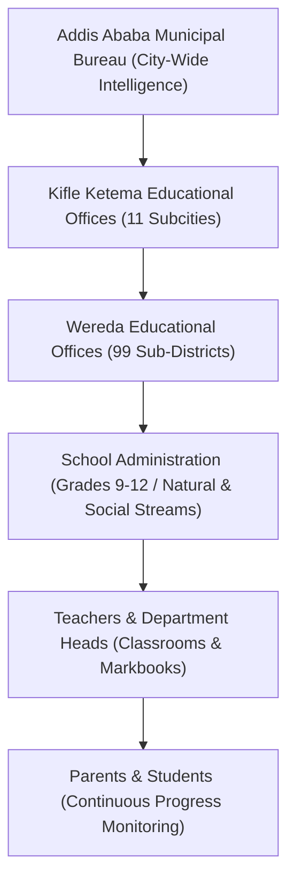

# LIQ

### Multi-Tier Educational Performance Intelligence & Academic Analytics Platform

[](https://www.python.org/)
[](https://flet.dev/)
[](https://streamlit.io/)
[](https://plotly.com/)
[](https://www.sqlite.org/)
[](https://cryptography.io/)

> **LIQ** is a centralized, hierarchical educational analytics and performance intelligence platform designed to revolutionize how academic data is captured, analyzed, and transformed into actionable interventions—scaling seamlessly from classroom markbooks to city-wide educational governance.

---

## Table of Contents

1. [Executive Summary](#executive-summary)
2. [Why LIQ Matters: Problem & Solution](#why-liq-matters-problem--solution)
3. [System Hierarchy & Access Architecture](#system-hierarchy--access-architecture)
4. [Main LIQ System Experience](#main-liq-system-experience)
5. [Core Dashboards & Implementation Modules](#core-dashboards--implementation-modules)
   - [Parent Portal](#1-parent-portal)
   - [Teacher Workspace & Markbook](#2-teacher-workspace--markbook)
   - [School Administration Dashboard](#3-school-administration-dashboard)
   - [Wereda Performance Dashboard](#4-wereda-performance-dashboard)
   - [Kifle Ketema / Subcity Dashboard](#5-kifle-ketema--subcity-dashboard)
   - [Addis Ababa City Command Center](#6-addis-ababa-city-command-center)
6. [Analytics Engine & Key Capabilities](#analytics-engine--key-capabilities)
   - [Dynamic Assessment Breakdown](#dynamic-assessment-breakdown)
   - [Comparative Multi-Level Analytics](#comparative-multi-level-analytics)
   - [Early Warning & Risk Detection Heuristics](#early-warning--risk-detection-heuristics)
   - [Actionable Trend Forecasting](#actionable-trend-forecasting)
7. [Traditional Systems vs. LIQ](#traditional-systems-vs-liq)
8. [Security, Privacy & Data Integrity](#security-privacy--data-integrity)
9. [Technology Stack](#technology-stack)
10. [Repository Structure](#repository-structure)
11. [Getting Started & Installation](#getting-started--installation)
12. [Future Roadmap](#future-roadmap)
13. [License & Acknowledgments](#license--acknowledgments)

---

## Executive Summary

Educational administration often operates with severe visibility bottlenecks: paper-based records, fragmented spreadsheets, delayed reporting periods, and isolated data silos that obscure student struggles until it is too late to intervene.

**LIQ** solves this structural failure through a multi-tiered, data-driven software architecture. Built using a dual-frontend ecosystem—a **Flet (Flutter engine)** cross-platform desktop/web application for secure role-based data capture and operational workflows, alongside a **Streamlit & Plotly** macro-intelligence analytical suite—LIQ bridges the entire educational accountability chain:

```
Students & Parents ⇄ Teachers ⇄ School Leadership ⇄ Wereda Offices ⇄ Subcity (Kifle Ketema) ⇄ Municipal Bureau (Addis Ababa)
```

By providing real-time KPI synthesis, multi-dimensional heatmaps, longitudinal score tracking, and automated at-risk identification, LIQ transforms raw marks into proactive pedagogical intelligence.

---

## Why LIQ Matters: Problem & Solution

```
┌────────────────────────────────────────────────────────┐
│               Traditional Education Systems            │
│  Manual Entry ➔ Delayed Reports ➔ Reactive Interventions │
└───────────────────────────┬────────────────────────────┘
                            │ LIQ Paradigm Shift
                            ▼
┌────────────────────────────────────────────────────────┐
│                      LIQ Platform                      │
│  Live Capture ➔ Real-Time Synthesis ➔ Proactive Action   │
└────────────────────────────────────────────────────────┘
```

### The Challenges in Contemporary Educational Management

* **Information Fragmentation:** Data lives in physical markbooks or disparate files, making historical trend analysis impossible.
* **Delayed Feedback Loops:** Parents and administrators often discover academic decline only at the end of a semester or academic year.
* **Absence of Standardized Benchmarks:** Comparing class sections, departments, schools, or entire districts is bottlenecked by inconsistent data formats.
* **Invisible Equity & Performance Gaps:** Systemic disparities across subjects or geographic zones remain hidden without interactive macro-visualizations.

### How LIQ Solves These Challenges

* **Unified Single Source of Truth:** Centralized database schema tracking students, subjects, quarters, granular assessment components, and attendance.
* **Transparent Multi-Level Drilldown:** High-level policymakers can observe city-wide benchmarks while school heads and teachers drill down to section-level and student-level granularities.
* **Automated Early Warning Signals:** Algorithmic detection flags students scoring below passing thresholds (<60%) or experiencing significant quarter-over-quarter drops.
* **Data-Informed Resource Allocation:** Wereda and Subcity officials can identify exactly which subjects or schools require pedagogical support, teacher training, or curriculum adjustments.

---

## System Hierarchy & Access Architecture

LIQ enforces strict role-based access scopes tailored to the institutional governance model:

| Governance Level | Primary Role | Scope of Access | Key Operational Focus |
| :--- | :--- | :--- | :--- |
| **Parent / Guardian** | Parent | Individual Student Record | Child component breakdown, quarter trends, teacher feedback |
| **Classroom Staff** | Teacher | Assigned Classes & Sections | 5-component markbook, attendance, semester top-performers |
| **School Administration** | Principal / Academic Head | School-Wide (Grades 9–12) | Section comparisons, track streams (Natural/Social), pass rates |
| **Wereda Administration** | District Educational Officer | Multi-School District | School rankings, inter-school KPI benchmarks, variance analysis |
| **Kifle Ketema (Subcity)** | Regional Educational Bureau | Subcity Weredas & Schools | Regional heatmap analysis, district-level equity & pass comparisons |
| **Addis Ababa Central** | Municipal Bureau / Policymakers | All 11 Kifle Ketemas & 99 Weredas | City-wide KPIs, executive priority tracking, systemic macro trends |



---

## Main LIQ System Experience

The core LIQ portal delivers a welcoming, human-centered entry point designed for high usability across varying digital literacy levels.

### Visual Identity & Welcome Interface

The portal welcomes users into an interactive, intuitive space connecting students, educators, and families with clear aesthetic principles and responsive design.


### Launch & Role Selection Workflow

A streamlined initiation pathway routes users to their authenticated environment based on regional identity, district credentials, and administrative roles.


---

## Core Dashboards & Implementation Modules

---

### 1. Parent Portal

The **Parent Portal** provides families with immediate, unmediated visibility into their child's academic trajectory, eliminating surprises at report card time.

#### Key Features:
* **Real-Time KPI Cards:** Overall average score, highest-performing subject, areas requiring attention, and quarter completion indicators.
* **Component-Level Trend Analysis:** Longitudinal line charts tracking progress across all five continuous assessment categories (Worksheets, Tests, Assignments, Midterm Exam, Final Exam).
* **Subject Breakdown & Performance Distribution:** Visual radar/donut distributions highlighting subject mastery balance.
* **Direct Feedback Integration:** Access to teacher observations, notes, and academic guidance.

#### Portal Screenshots:


---

### 2. Teacher Workspace & Markbook

The **Teacher Workspace** provides classroom instructors with an ergonomic, live academic management environment for grading, attendance, and student performance diagnostics.

#### Key Features:
* **Granular 5-Component Markbook:** Live validation and grade capture across standard academic components (Worksheet /10, Test /10, Assignment /10, Mid Exam /30, Final Exam /40) with automated sum aggregation.
* **Attendance Tracking:** Built-in tracking of yearly and quarterly student attendance rates.
* **Class Average & Trend Diagnostics:** Real-time calculation of overall section average, leading subjects, and quarter-by-quarter score trajectories.
* **Recognition Snapshots & Dynamic Rankings:** Automated computation of Top 5 performers per semester and full academic year, alongside multi-quarter ranking matrices.

#### Portal Screenshots:


---

### 3. School Administration Dashboard

The **School Administration Dashboard** provides institutional leadership with an executive cockpit for monitoring academic standards across all grade levels and specialized streams.

#### Key Features:
* **Academic Stream Separation:** Specialized monitoring for General Secondary (Grades 9–10) and Preparatory Streams (Grade 11 & 12 Natural Science vs. Social Science).
* **Institutional Health Metrics:** Real-time computation of School Overall Average, Pass Rate ($\ge 60\%$), Distinction Rate ($\ge 75\%$), and At-Risk Population ($\lt 60\%$).
* **Cross-Section Comparative Analytics:** Side-by-side performance benchmarks across sections (e.g., 11A vs. 11B vs. 11C vs. 11D).
* **Departmental Variance Tracking:** Instant detection of subject performance gaps and score dispersion across classes.

#### Portal Screenshots:


---

### 4. Wereda Performance Dashboard

The **Wereda Dashboard** equips district education officers with multi-school governance tools to evaluate institutional quality and allocate targeted educational support.

#### Key Features:
* **Multi-School Benchmarking:** Direct comparative tracking across all public and private institutions within the district (e.g., NEPS, Omega, Cruise, School of Tomorrow, BGIS, etc.).
* **Wereda KPI Heatmaps:** Matrix visualizations color-coding Average Scores, Pass Rates, Distinction Percentages, and At-Risk Rates across schools and sub-units.
* **Performance Gap Detection:** Rapid identification of outlier institutions and struggling grade cohorts.
* **District Ranking Tables:** Sortable, evidence-based performance rankings to foster transparency and healthy institutional development.

#### Portal Screenshots:


---

### 5. Kifle Ketema / Subcity Dashboard

The **Kifle Ketema Dashboard** provides regional directors with cross-wereda oversight to monitor educational equity, resource effectiveness, and district trends.

#### Key Features:
* **Subcity Operational Matrix:** Macro monitoring across all weredas within the subcity jurisdiction.
* **Pass Rate vs. At-Risk Cross-Analysis:** High-impact comparative bar charts contrasting passing percentages directly against at-risk populations per district.
* **Subcity $\times$ Subject Heatmaps:** Comprehensive 2D matrix mapping average scores by subject (Mathematics, English, Amharic, Physics, Chemistry, Biology, Social Studies) across all weredas.
* **District Improvement Tracking:** Quarter-over-quarter percentage delta calculations identifying advancing and stagnating districts.

#### Portal Screenshots:


---

### 6. Addis Ababa City Command Center

The **Addis Ababa City Dashboard** serves as the executive macro-intelligence command center for municipal educational authorities, policy researchers, and government stakeholders.

#### Key Features:
* **City-Wide Macro Analytics:** Aggregates metrics across all 11 Kifle Ketemas (Bole, Arada, Yeka, Kirkos, Lideta, Addis Ketema, Akaki Kality, Kolfe Keranio, Nifas Silk-Lafto, Gulele, Lemi Kura) and 99 constituent Weredas.
* **Executive Priority Categorization:** Automated classification highlighting Top Performing Subcities (e.g., *Nifas Silk-Lafto*) alongside zones requiring immediate intervention (e.g., *Addis Ketema*).
* **Cross-Subcity Benchmarking & Rankings:** Standardized comparative rankings evaluating municipal pass rates, distinction yields, and term improvement.
* **City-Wide Subject Heatmap:** Granular subject-by-subcity matrix uncovering systemic curricular strengths and vulnerabilities across the capital.

#### Portal Screenshots:


---

## Analytics Engine & Key Capabilities

LIQ is powered by a modular analytics backend (`helpers/analytics.py` and `services/analytics.py`) that processes raw grade inputs into multidimensional statistical insights.

### Dynamic Assessment Breakdown

LIQ implements the standard 5-component continuous assessment model, enforcing strict boundary checking and automatic total summation:

$$\text{Total Score} = \text{Worksheet}_{(0-10)} + \text{Test}_{(0-10)} + \text{Assignment}_{(0-10)} + \text{Mid Exam}_{(0-30)} + \text{Final Exam}_{(0-40)}$$

```python
COMPONENTS = {
    "Worksheet (0-10)": 10,
    "Test (0-10)": 10,
    "Assignment (0-10)": 10,
    "Mid Exam (0-30)": 30,
    "Final Exam (0-40)": 40,
}
```

### Comparative Multi-Level Analytics

* **Class Average per Subject:** Computes arithmetic means grouped by subject discipline.
* **Subject Performance Spread:** Calculates $\text{Spread} = \max(\text{Mark}) - \min(\text{Mark})$ to identify learning inequality within sections.
* **Statistical Score Variance:** Quantifies class heterogeneity using sample variance ($\sigma^2$).
* **Term-over-Term Improvement:** Measures longitudinal momentum across quarters:
  $$\Delta \% = \left(\frac{\mu_{\text{Term 2}} - \mu_{\text{Term 1}}}{\mu_{\text{Term 1}}}\right) \times 100$$

### Early Warning & Risk Detection Heuristics

Rather than waiting for semester failure, LIQ applies active heuristic thresholds to categorize student and institutional risk:

* **Distinction Benchmark ($\ge 75\%$):** Identifies high-achieving cohorts for honors and scholarship programs.
* **Active Baseline ($\ge 65\%$):** Evaluates engagement health and curriculum absorption.
* **At-Risk / Critical Threshold ($< 60\%$):** Automatically triggers warning banners and diagnostic notes for teachers, administrators, and parents.
* **Subject Vulnerability Alerts:** Flags subjects where the section average drops below $70\%$ (moderate concern) or $60\%$ (critical intervention required).

### Actionable Trend Forecasting

LIQ utilizes rule-based performance trajectory evaluations to generate automated pedagogical advice:

```python
def get_prediction_trend(df: pd.DataFrame) -> str:
    overall_avg = df["Mark"].mean()
    subject_avg = get_class_avg_per_subject(df)
    weak_subjects = subject_avg[subject_avg < 70].index.tolist()
    critical_subjects = subject_avg[subject_avg < 60].index.tolist()

    if overall_avg >= 75:
        return "Strong overall performance. Academic trajectory is projected to remain excellent."
    elif overall_avg >= 65:
        return f"Moderate performance. Targeted intervention in ({', '.join(weak_subjects)}) recommended to accelerate growth."
    else:
        return f"Below-average performance detected. Urgent intervention required in: {', '.join(critical_subjects)}."
```

---

## Traditional Systems vs. LIQ

| Operational Dimension | Traditional Educational Practices | The LIQ Platform |
| :--- | :--- | :--- |
| **Data Collection** | Paper registers, manual markbooks, unlinked Excel files | Centralized relational database with ACID transactions |
| **Reporting Latency** | End-of-term or end-of-year batch compilation | Instant real-time metric computation upon grade entry |
| **Data Transparency** | Restricted, fragmented, and vulnerable to manual error | Role-based, verifiable, hierarchical data visibility |
| **Analytical Depth** | Basic sum and manual averages | Statistical variance, score spread, quartile analysis, heatmaps |
| **Early Warning** | Reactive; discovered after exam failure | Proactive; automated at-risk flags and component trend tracking |
| **Cross-School Comparisons** | Labor-intensive manual surveys with delayed synthesis | Live multi-school, Wereda, and Subcity comparative dashboards |
| **Parent Engagement** | Infrequent paper report cards and physical meetings | Continuous digital visibility into component trends and teacher notes |
| **Data Security** | Unencrypted spreadsheets and physical paper records | Bcrypt credential hashing + Fernet AES-128 PII encryption |

---

## Security, Privacy & Data Integrity

Educational records contain sensitive personally identifiable information (PII). LIQ implements defense-in-depth architectural safeguards:

```
┌────────────────────────────────────────────────────────┐
│                   LIQ Security Layer                   │
│                                                        │
│  [ Passwords ] ──► Bcrypt Hashing (Salts + Work Factor) │
│  [ Student PII] ──► Fernet AES-128-CBC + HMAC-SHA256    │
│  [ Database  ] ──► Foreign Keys (ON DELETE CASCADE)    │
│  [ Audit Log ] ──► Immutable Activity Logging Table    │
└────────────────────────────────────────────────────────┘
```

1. **Bcrypt Password Protection:** User and administrative credentials are never stored in plaintext; salted and hashed with adaptive work factors.
2. **Fernet Symmetric Encryption:** Student identification codes and sensitive log parameters are encrypted via AES-128 in CBC mode with PKCS7 padding and HMAC authentication.
3. **Relational Integrity & Cascades:** SQLite foreign key constraints (`PRAGMA foreign_keys = ON`) enforce referential integrity across students, subjects, terms, grades, and attendance.
4. **Comprehensive Activity Audit Trail:** Dedicated `activity_log` records authentication events, role transitions, account updates, and system modifications.
5. **Separation of Admin Accounts:** Administrative credentials and privilege sets are isolated in an independent `admin_accounts` table.

---

## Technology Stack

```text
┌──────────────────────────────────────────────────────────────────────────┐
│                             Technology Stack                             │
│                                                                          │
│  UI Frameworks:     Python 3.11+, Flet (Flutter Engine), Streamlit       │
│  Analytics Engine:  Pandas, NumPy, Plotly Express & Graph Objects       │
│  Data Layer:        SQLite3 Relational DB, Openpyxl (Excel I/O)         │
│  Security Suite:    Bcrypt, Cryptography (Fernet AES-128)                │
│  Build Tools:       Visual Studio C++ Tools, Java JDK 17, Android SDK    │
└──────────────────────────────────────────────────────────────────────────┘
```

### 1. Programming Language & Core Frameworks
* **[Python 3.11+](https://www.python.org/):** Primary backend and application logic runtime.
* **[Flet (Flutter UI Engine)](https://flet.dev/):** Powers the modern, responsive desktop and web client applications with reactive state management.
* **[Streamlit](https://streamlit.io/):** Powers the high-performance macro-analytical dashboards for School Admins, Weredas, Subcities, and Addis Ababa.

### 2. Data Processing & Data Visualization
* **[Pandas](https://pandas.pydata.org/):** High-performance data manipulation, multi-index aggregation, and pivot operations.
* **[NumPy](https://numpy.org/):** Vectorized mathematical calculations, variance analysis, and statistical distributions.
* **[Plotly Express & Graph Objects](https://plotly.com/python/):** Interactive choropleth-style heatmaps, comparative bar charts, multi-line trend trackers, and donuts.
* **[Openpyxl](https://openpyxl.readthedocs.io/):** Structured Excel import/export for batch gradebook ingestion.

### 3. Database & Security Engineering
* **[SQLite3](https://www.sqlite.org/):** Serverless, ACID-compliant relational storage supporting multi-table joins and cascaded deletions.
* **[Bcrypt](https://pypi.org/project/bcrypt/):** Cryptographic password hashing and verification.
* **[Cryptography (Fernet)](https://cryptography.io/):** Authenticated cryptography for sensitive records.

---

## Repository Structure

```text
LIQ/
├── README.md                           # Comprehensive documentation & visual showcase
├── requirements.txt                    # Python runtime dependencies
├── pyproject.toml                      # Project metadata and configuration
├── main.py                             # Flet application launch entry point
├── pro.py                              # Master consolidated application engine
│
├── dashboard.py                        # School Administration Streamlit Dashboard
├── admin_dashboard.py                  # Grade-level & section analytics dashboard
├── wereda_dashboard.py                 # Wereda multi-school performance dashboard
├── kifle_ketema_dashboard.py           # Kifle Ketema regional performance dashboard
├── addis_ababa_dashboard.py            # Addis Ababa city-wide command dashboard
│
├── flet_app/                       # Modular Flet application package
│   ├── main.py                         # Flet application lifecycle controller
│   ├── constants.py                    # Regional, school, and assessment constants
│   ├── components/                     # Reusable UI widgets (charts, banners, tables)
│   ├── services/                       # Database, analytics, and cross-platform path services
│   ├── state/                          # Application, authentication, and selection state
│   └── views/                          # Role-based view modules (admin, parent, teacher, setup)
│
├── helpers/                            # Analytics, data generation, and plotting engine
│   ├── analytics.py                    # Statistical, ranking, and early-warning algorithms
│   ├── charts.py                       # Plotly visualization generators
│   ├── data_gen.py                     # School-level data modeling & mock datasets
│   ├── wereda_data.py                  # Wereda-level data models and KPI helpers
│   ├── kk_data.py                      # Subcity-level data models and KPI helpers
│   ├── aa_data.py                      # Addis Ababa city-level data models and heatmaps
│   └── ui_components.py                # Streamlit CSS styling and custom UI cards
│
├── app/
│   └── backend/
│       └── db_functions.py             # SQLite ORM functions, encryption, and audit log
│
├── assets/                             # Logos, branding graphics, and institutional badges
│
└── screenshots/                        # Documentation image assets
    ├── liq/                            # LIQ welcome and launch screenshots
    ├── parent/                         # Parent portal screenshots
    ├── teacher/                        # Teacher workspace and markbook screenshots
    ├── admin/                          # School administration dashboard screenshots
    ├── wereda/                         # Wereda performance dashboard screenshots
    ├── sub/                            # Kifle Ketema / Subcity dashboard screenshots
    └── aa/                             # Addis Ababa city command center screenshots
```

---

## Getting Started & Installation

### Prerequisites

* Python `3.11` or higher installed
* Git installed
* Recommended: Virtual environment (`venv` or `conda`)

### 1. Clone the Repository
```bash
git clone https://github.com/your-username/LIQ.git
cd LIQ
```

### 2. Set Up Virtual Environment
```bash
# Windows
python -m venv venv
.\venv\Scripts\activate

# Linux / macOS
python3 -m venv venv
source venv/bin/activate
```

### 3. Install Dependencies
```bash
pip install -r requirements.txt
```

### 4. Launch the Application

#### Run the Flet Multi-Platform Desktop/Web App:
```bash
python main.py
```

#### Run the Regional Intelligence Dashboards (Streamlit):
```bash
# School Admin Dashboard
streamlit run dashboard.py

# Wereda Performance Dashboard
streamlit run wereda_dashboard.py

# Kifle Ketema Regional Dashboard
streamlit run kifle_ketema_dashboard.py

# Addis Ababa City-Wide Intelligence Dashboard
streamlit run addis_ababa_dashboard.py
```

---

## Future Roadmap

While the core LIQ platform provides robust multi-tier monitoring, the following enhancements are planned for future development milestones:

* [ ] **Machine Learning Predictive Engine:** Integration of supervised classification models (e.g., Random Forests / XGBoost) trained on historical multi-year datasets to forecast national examination pass probabilities.
* [ ] **Automated SMS & USSD Push Notifications:** Direct telecommunication integration to deliver low-bandwidth grade alerts to parents without internet access.
* [ ] **National Examination Data Ingestion:** Standardized connectors for National Educational Assessment and Examinations Agency (NEAEA) grade imports.
* [ ] **Offline-First P2P Synchronization:** SQLite database replication supporting low-connectivity rural school environments with automated sync upon internet reconnection.
* [ ] **Mobile Native Builds:** Compiling specialized Android APK and iOS binaries using Flet Flutter build pipelines for field officers and educators.

---

## License & Acknowledgments

* **License:** Developed for academic, research, and educational development purposes.
* **Special Thanks:** Dedicated to all educators, school administrators, and students whose daily commitment drives academic progress.

---

<div align="center">
  <sub><strong>LIQ</strong> — Making Learning Measurable, Transparent, and Actionable.</sub>
</div>
